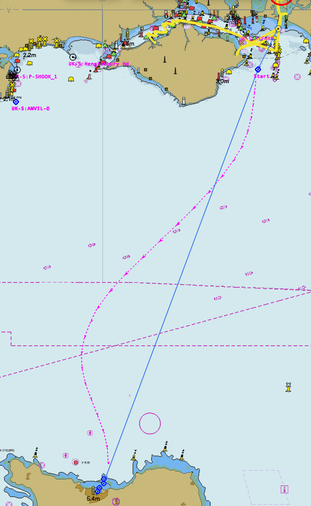
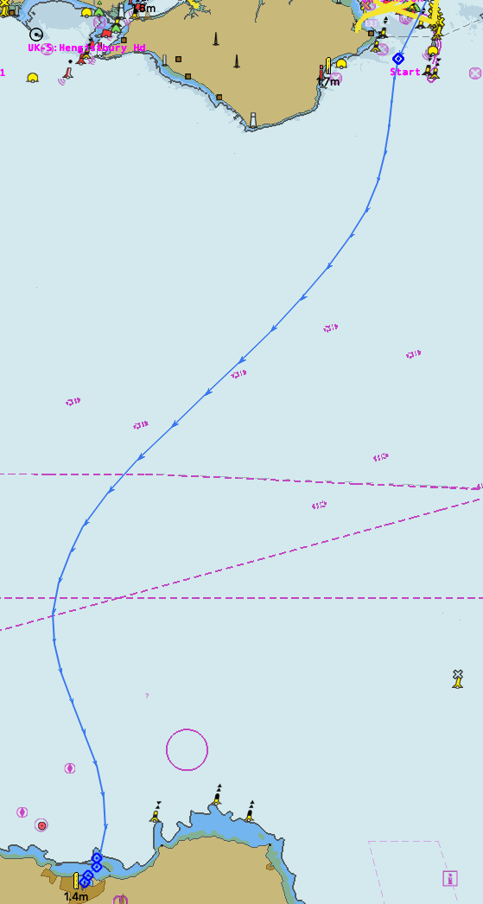

= Currents
:table-caption!:

== What this script addresses

When planning a passage, you may want to take account of currents.  For example,when crossing the English Channel, a boat is carried up and down the Channel by the tides.  Best practice is to steer a steady heading through the water (HDG) such that it arrives at the destination.

This script can use a GRIB current prediction file to calculate a predicted route that can be steered with a constant HDG.

The chart on the left shows a planned route for a passage from Chichester Harbour across the Channel to Cherbourg.

Current planning is to commence from the routepoint named _Start_ off the east end of the Isle of Wight.
In the absence of currents, this requires a HDG of 100ºT.

The Currents script has been used to calculate that we actually need a HDG of 102ºT and it has created a purple route showing the predicted track.

The script has then been used to insert the predicted section into the route and it has displayed the ETA.
See the chart on the right.
You could now sail that route and the HDG during the current corrected section should be a constant 102ºT.

 

[cols="1,1", width=100%, frame=none, grid=none]
|===
a|image::images/Crossing_with_prediction.png[Planned route, width=100%]
a|image::images/Inserted_prediction.png[Route with prediction inserted, width=100%]
|===

Sometimes a passage is constrained.
While crossing from Shetland to Norway, we needed to pass through a gap between two oil fields.

The Currents script can handle predictions for any leg of a route.
On the chart on the left, I have imagined a requirement to pass through such a gap and have inserted two routepoints for this.
I have then created predictions for the leg before the gap when the HDG is 209ºT and after the gap when the HDG is 203ºT.
On the right I have inserted both predictions into the route.

[cols="1,1", width=100%, frame=none, grid=none]
|===
a|image::images/Restricted.png[Restricted route, width=100%]
a|image::images/Inserted_restricted.png[Restricted route with predictions inserted, width=100%]
|===

== Installing the script

This script needs JavaScript plugin v4.1 or later.

1. Copy this URL to your clipboard (copy link - do not follow it) `https://raw.githubusercontent.com/antipole2/Currents/main/currents.js`
2. In a JavaScript console choose `Load` and then `URL on clipboard`.  The script should be loaded into the script pane.
3. Choose `Run` to start the script.

If you want to run the script when not online, you will need to save it to a local file.  You can tick the _Auto run_ box to have the script start automatically.

Alternatively, you can fork the repository if you want to evolve the script.

== What the script does

The script adds a route context menu with sub-menus which which themslvesvary with context.

=== Currents sub-menus
[cols="2,2,2"]
|===
|Context|Sub-menus|Function

|Route is not a currents working route|Select for current planning| Creates a working copy of the route.
|Context is not part of a prediction|Create prediction|Generates a predicted path from the preceeding routepoint to the next routepoint using a constant CTW to arrive at the next route point. The path is shown as a OpenCPN route named Predicted.
|===

=== Successive repeated routepoints
Suppose you have a route used to visit a series of lobster pots in two bays.  Your route might have routepoints like this:

. Home port
. Sandy Bay
. Pot 1
. Pot 2
. Sandy Bay
. Rocky Cove
. Pot A
. Pot B
. Rocky Cove
. Pot C
. Rocky Cove
. Home Port

Now suppose it is the end of the season.
You lift the pots and delete their marks.
You are now left with the route:

. Home port
. Sandy Bay
. Sandy Bay
. Rocky Cove
. Rocky Cove
. Rocky Cove
. Home Port

Housekeeper will spot this and remove the repeated routepoints, leaving you with:

. Home port
. Sandy Bay
. Rocky Cove
. Home Port

Now suppose you stop visiting Sandy Bay and Rocky Cove and remove them.
Your route would now be:

. Home port
. Home Port

Housekeeper will spot that when it removes the repeated point, you will be left with a singleton route with just a starting point and it will delete the route.

From v1.2, Housekeeper identifies a repeated point when its location is within the `nearby` distance from the previous point.  It no longer needs to be the same mark.

The above example may seem unlikely, but Housekeeper has found two real cases of a repeated routepoint in my routes.

=== Co-located waypoints
Housekeeper will identify multiple marks at the same lcation. There is an option at the start of the script

`nearby = 0.01;	//two points this close in nm regarded as at same position`

This specifies how close points need to be before they are regarded as at the same point.
You can adjust this to your own requirement.

NOTE: I use the term _waypoint_ to refer to a mark which exists independently of a route and which will be listed in the Waypoints tab of the Route & Mark Manager.
I use the term _routepoint_ to refer to a mark which exists only in a route.  Routepoints are not included in the list of waypoints.  When a route is deleted, its routepoints are also deleted unless they are being used in another route.  Any included waypoints are not deleted.  I here use the term _point_ when it may be either a waypoint or a routepoint.

When you add a routepoint to a route, OpenCPN will offer to use any nearby point.
If you accept this, the point may be shared by more than one route.
If you decline, you will have more than one point at this location.

==== Imported waypoints and routes

When I adopted OpenCPN, I exported my substantial library of waypoints from my old system (MacENC) as GPX files and imported them into OpenCPN.
I then imported my routes, imagining OpenCPN would link the waypoints into routes.

OpenCPN does not work like that.

When you add waypoints by importing them from a GPX file, OpenCPN creates new waypoints, even if waypoints with the same name already exist.

When you import a route from a GPX file, OpenCPN creates a new route with a set of routepoints, ignoring any existing waypoints or routes.

You can end up with multiple waypoints and routepoints at the same location.
These may exactly overlay each other and you may not even be aware there are multiple copies - unless you shift one of them.

In my case, Housekeeper found I had duplicate marks at several locations - as many as *eight* in some cases.
And if, when editing a route,  you accept the invitation to use a nearby mark, you will not know which of multiple marks at that location will be used.

WARNING: Mutiple duplicated marks are dangerous, in my opinion.  Suppose you need to move a mark because a channel has shifted or a new obstruction has been identified.  If you have multiple marks, they all need to be moved.  If some of them are hidden at the time you move the mark, they will retain their old location.  You may end up sailing a route with a mark in its old position.

To avoid this problem, it is best to share a mark.
Houskeeper will identify multiple waypoints or routepoints at the same location, list them and offer to share one for all routes with a point at that location.

The options presented depend on the situation at the location, as follows

|===
|Situation at this location|Offered solution

|Multiple waypoints none of which are used in any route|Choose which waypoints to delete
|Single waypoint which may or may not be used in a route and other routepoints|Share the waypoint in all routes
|Multiple waypoints and one or more route points|Choose which waypoint to use as shared waypoint in all routes
|Multiple routepoints but no waypoint|Choose which routepoint to share in all routes
|===

== Saving the changes

When all issues have been dealt with, either by adopting the proposed change or by skipping the action,
you have the option of saving the changes back into OpenCPN.
If you stop the script without this step, nothing will be changed.

== Duplicate GUIDs

This script has found that sometimes OpenCPN has multiple entries for the same GUID.

If this is so, the script reports this and stops.

If you are unable to resolve the issue, you can choose to ignore the duplicates.
Change `ignoreDuplicates = false` to `ignoreDuplicates = true`

== Time-outs

This script may take significant time to run if there are many points to analyse.
It allocates itself extra time based on the number of GUIDs.
If you are running on a slow computer or with limited memory, it might still timeout.
The allocation adjustment is made in the function load( ) and you could adjust it.

== About the script

This script is complex.
There is a link:https://github.com/antipole2/Housekeeper/blob/main/Housekeeper_tech_guide.adoc[technical description] that documents how the script works.
You should familiarise yourself with this before attempting to modify it.
