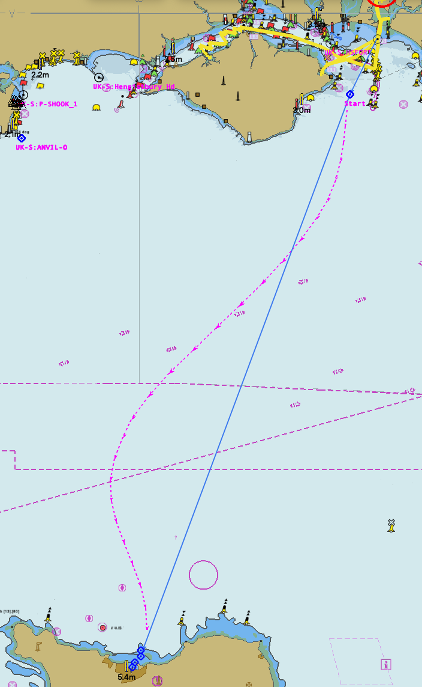
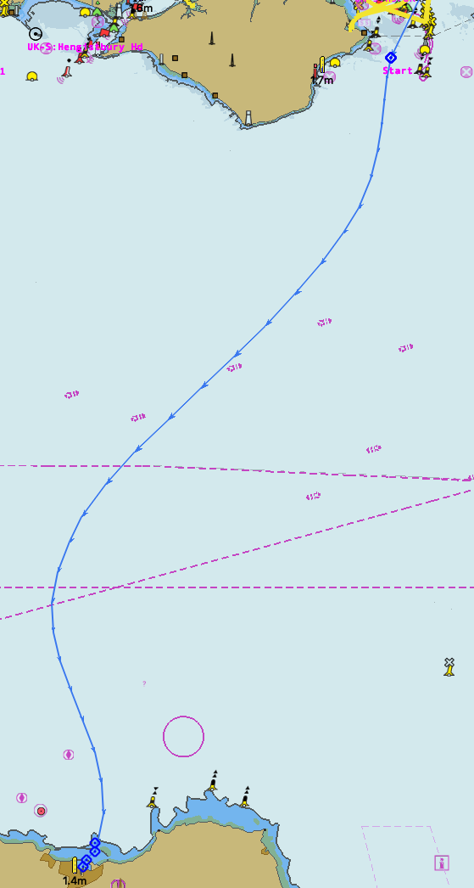
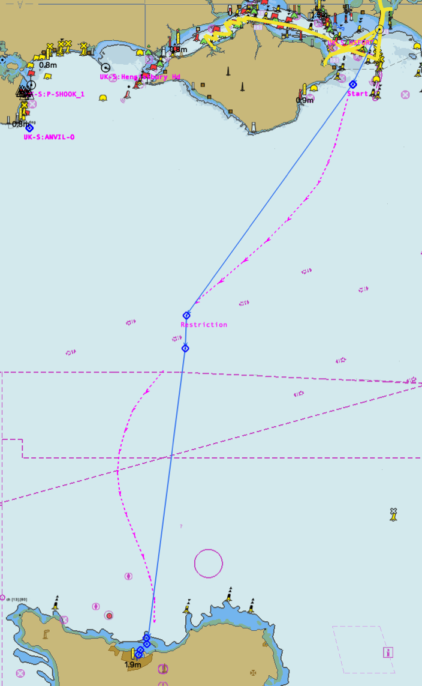
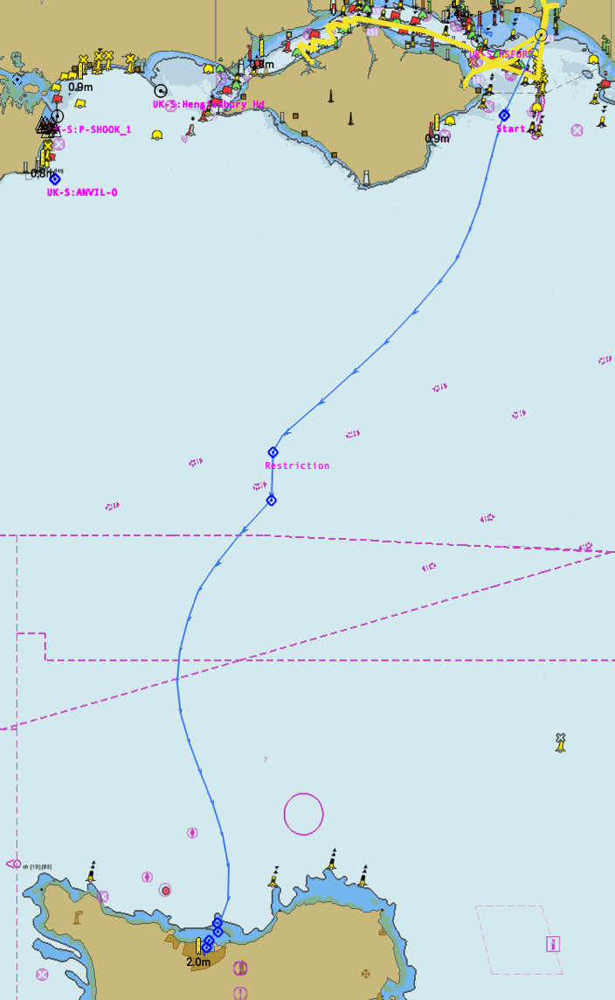
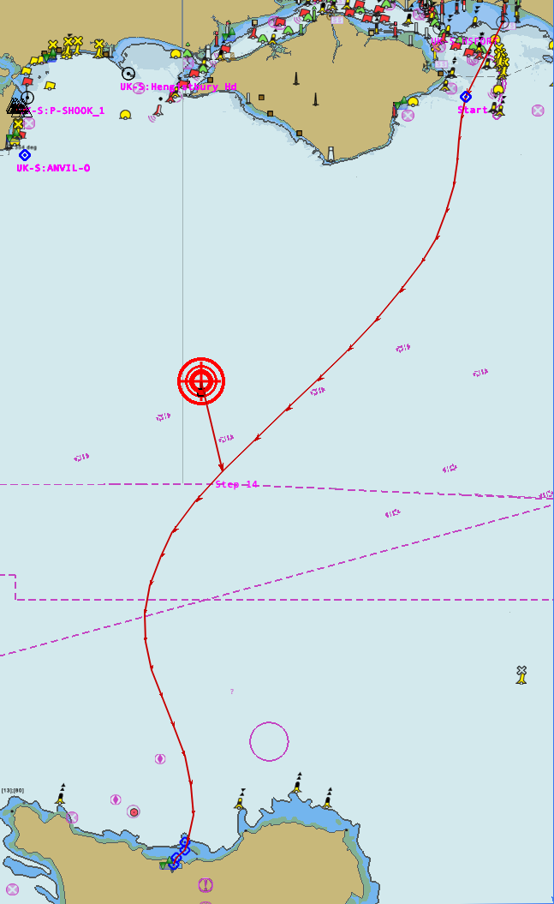
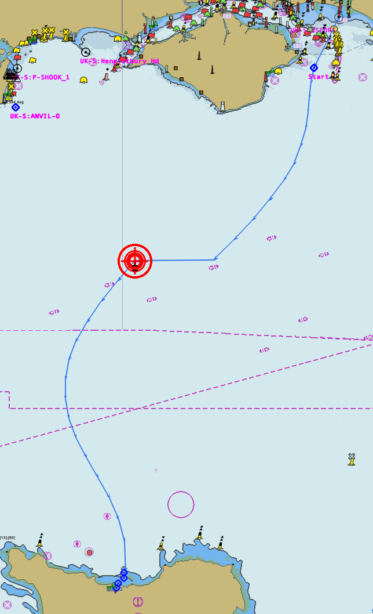

= Currents
:table-caption!:

== What this script addresses

When planning a passage, you may want to take account of currents.  For example,when crossing the English Channel, a boat is carried up and down the Channel by the tides.  Best practice is to steer a steady heading through the water (HDG) such that it arrives at the destination.

This script can use a GRIB current prediction file to calculate a predicted route that can be steered with a constant HDG.

The chart below left shows a planned route for a passage from Chichester Harbour across the Channel to Cherbourg.

Current planning is to commence from the routepoint named _Start_ off the east end of the Isle of Wight.
In the absence of currents, this requires a HDG of 100ºT.

The Currents script has been used to calculate that we actually need a HDG of 102ºT and it has created a purple route showing the predicted track.

The script has then been used to insert the predicted section into the route and it has displayed the ETA.
See the chart below right.
You could now sail that route and the HDG during the current corrected section should be a constant 102ºT.

 

Sometimes a passage is constrained.
While crossing from Shetland to Norway, we needed to pass through a gap between two oil fields.

The Currents script can handle predictions for any leg of a route.
On the chart bellow left, I have imagined a requirement to pass through such a gap and have inserted two routepoints for this.
I have then created predictions for the leg before the gap when the HDG needs to be 209ºT and after the gap when the HDG needs to be 203ºT.
Below right I have inserted both predictions into the route.

 

Sometimes a passage does not go to plan.
You might need to tack, or, if becalmed for a while you might be carried off course.
The script can recalculate the prediction when required.

In the chart below left, the boat has strayed well west of the predicted and active route.
The script has been given a revised Speed Through Water, recalculated a predicted route (shown below right).  It now advises to steer 194ºT and has given a revised ETA.

 

== Installing the script

This script needs JavaScript plugin v4.1 or later.

1. Copy this URL to your clipboard (copy link - do not follow it) `https://raw.githubusercontent.com/antipole2/Currents/main/currents.js`
2. In a JavaScript console choose `Load` and then `URL on clipboard`.  The script should be loaded into the script pane.
3. Choose `Run` to start the script.

If you want to run the script when not online, you will need to save it to a local file.  You can tick the _Auto run_ box to have the script start automatically.

Alternatively, you can fork the repository if you want to evolve the script.

== Preparation

. Prepare your route
.. Set the start time as the time you will beat the first routepoint (not your depature towardsthe first point)
.. Set the planned speed for the route - this becomes the default speed for the route
.. If you foresee different speeds for different lesg, you can set their spped in the route points
. Get the forecast currents using the _grib_ or _xgrib_ plugin.  These need to cover the whole route and its timespan.
Having the plugin active with the the required grib file is sufficient.  You do not need the currents visible on the chart.

NB There is an link:https://github.com/OpenCPN/OpenCPN/issues/5575[issue with OpenCPN] when a route is used in varying time zones.  The start time ay be confusing.

=== Sources of current predictions inlude:

* link:https://marine.copernicus.eu[Copernicus]
* link:https://www.bsh.de/EN/DATA/Predictions/Currents/Surface_currents_for_sailors/surface_currents_for_sailors_node.html[German Hyrographic Office]
* Detailed Irish current predictions are good for Ireland and as far east as the Isle of Wight.  https://www.cruisersforum.com/forums/f134/irish-hourly-tidal-current-gribs-200341.html#post2634287[See here.]

== What the script does

The script adds a route context menu which is used to contro its actions.  Sub-menus vary with context and are as follows:

=== Currents sub-menus

[cols="1,1,1"]
|===
|Context|Sub-menus|Function

|Route is not a currents working route|Select for current planning|If Yes selected, creates a working copy of the route. +
Initialises route for current predictions.
.2+|Context is not part of a prediction
|Create prediction|Generates a predicted path from the preceeding routepoint to the next routepoint using a constant CTW to arrive at the next route point. +
The path is shown as a purple OpenCPN route named _Predicted_.
|Show route info|Shows the planned start and predicted end time following any predicted sections +
and the bearing to the next routepoint.
.4+|Is a separate purple prediction called _Predicted_
|Insert into route|Inserts the predicted course into the working route.
|Regenerate prediction|Regenerates the prediction and replaces the purple route.
|Delete prediction|Deletes the prediction.
|Show prediction info|Shows the planned start and end times and course to steer.
.2+|Context is part of a prediction inserted into the route|Extract prediction|Extracts the predicted section into a free-standing purple prediction and closes the gap.
|Show route info|Shows the planned route start and predicted end time following any predicted sections and the course to steer.
|Route includes custom speeds in routepoints|Reset speeds to plan default|Deletes any predictions in the route +
resets speeds in routepoints to the route default.
|===

== About the script

This script is complex.
There is a link:https://github.com/antipole2/Currents/blob/main/currents_tech_guide.adoc[technical description] that documents how the script works.
You should familiarise yourself with this before attempting to modify it.

The decription also covers some of the techniques used, which might be useful for those developing other scripts.
