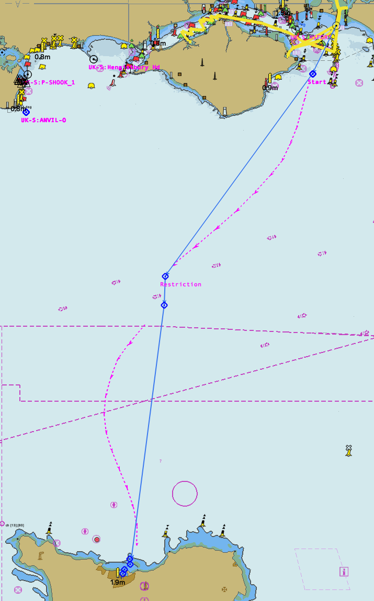
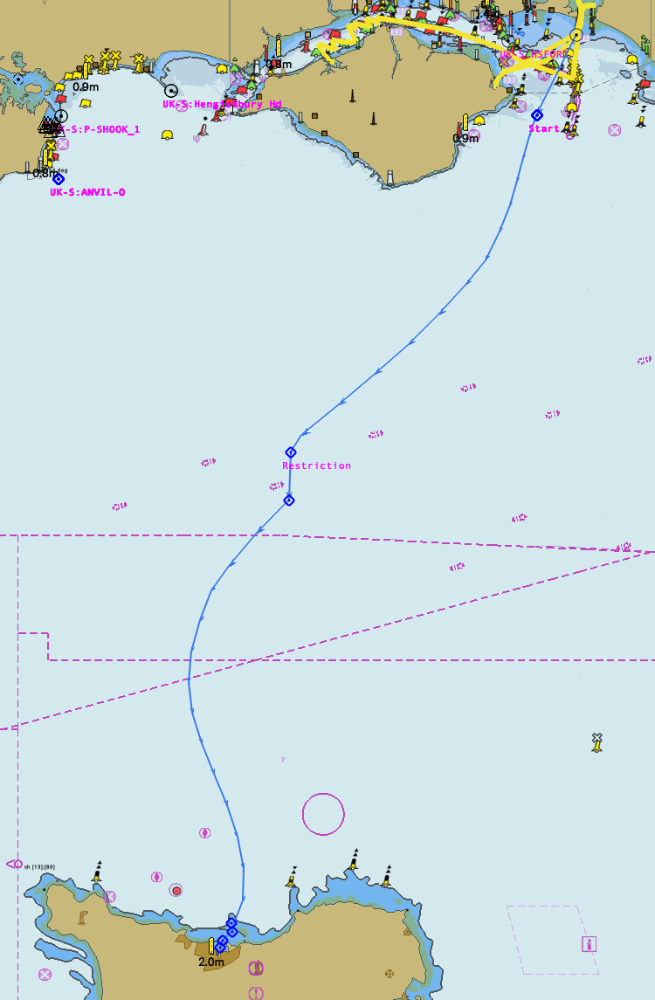

= Currents
:table-caption!:

== What this script addresses

When planning a passage, you may want to take account of currents.  For example,when crossing the English Channel, a boat is carried up and down the Channel by the tides.  Best practice is to steer a steady heading through the water (HDG) such that it arrives at the destination.

This script can use a GRIB current prediction file to calculate a predicted route that can be steered with a constant HDG.

The chart below left shows a planned route for a passage from Chichester Harbour across the Channel to Cherbourg.

Current planning is to commence from the routepoint named _Start_ off the east end of the Isle of Wight.
In the absence of currents, this requires a HDG of 100ºT.

The Currents script has been used to calculate that we actually need a HDG of 102ºT and it has created a purple route showing the predicted track.

The script has then been used to insert the predicted section into the route and it has displayed the ETA.
See the chart below right.
You could now sail that route and the HDG during the current corrected section should be a constant 102ºT.

image:images/Crossing_with_prediction.png[Planned route,width=49%] image:images/Inserted_prediction.png[Route with prediction inserted,width=49%]

Sometimes a passage is constrained.
While crossing from Shetland to Norway, we needed to pass through a gap between two oil fields.

The Currents script can handle predictions for any leg of a route.
On the chart bellow left, I have imagined a requirement to pass through such a gap and have inserted two routepoints for this.
I have then created predictions for the leg before the gap when the HDG needs to be 209ºT and after the gap when the HDG needs to be 203ºT.
Below right I have inserted both predictions into the route.

 

== Installing the script

This script needs JavaScript plugin v4.1 or later.

1. Copy this URL to your clipboard (copy link - do not follow it) `https://raw.githubusercontent.com/antipole2/Currents/main/currents.js`
2. In a JavaScript console choose `Load` and then `URL on clipboard`.  The script should be loaded into the script pane.
3. Choose `Run` to start the script.

If you want to run the script when not online, you will need to save it to a local file.  You can tick the _Auto run_ box to have the script start automatically.

Alternatively, you can fork the repository if you want to evolve the script.

== What the script does

The script adds a route context menu which is used to contro its actions.  Sub-menus vary with context and are as follows:

=== Currents sub-menus

[cols="1,1,1"]
|===
|Context|Sub-menus|Function

|Route is not a currents working route|Select for current planning| Creates a working copy of the route.
|Context is not part of a prediction|Create prediction|Generates a predicted path from the preceeding routepoint to the next routepoint using a constant CTW to arrive at the next route point. The path is shown as a OpenCPN route named _Predicted_.
.2+|Is a separate purple prediction called _Predicted_|Insert into route|Inserts the predicted course into the working route.
|Delete prediction| Deletes the prediction.
|===

== About the script

This script is complex.
There is a link:https://github.com/antipole2/Housekeeper/blob/main/Housekeeper_tech_guide.adoc[technical description] that documents how the script works.
You should familiarise yourself with this before attempting to modify it.
